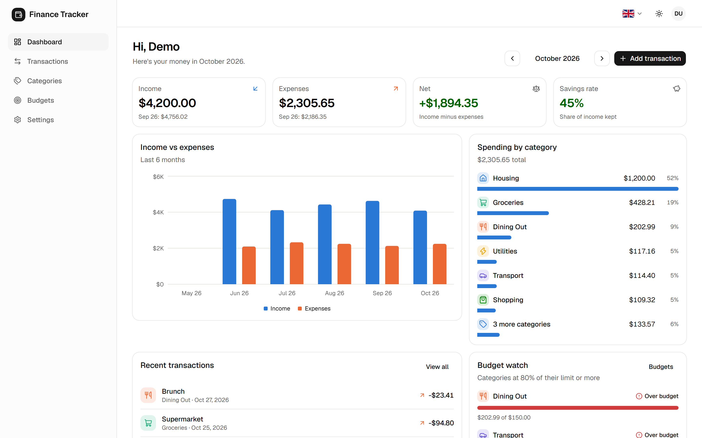
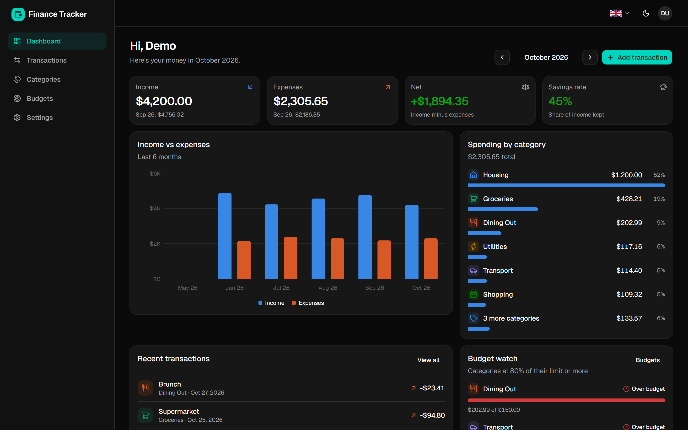
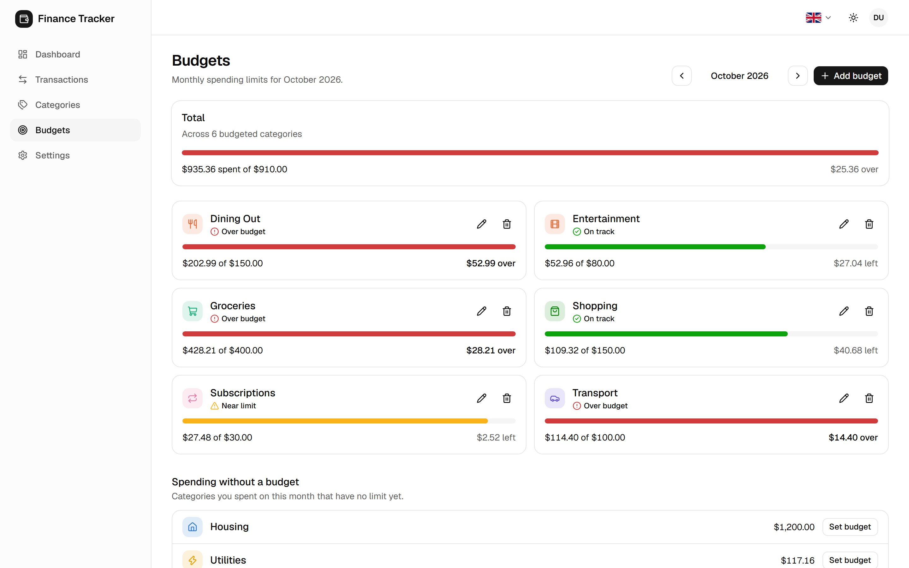
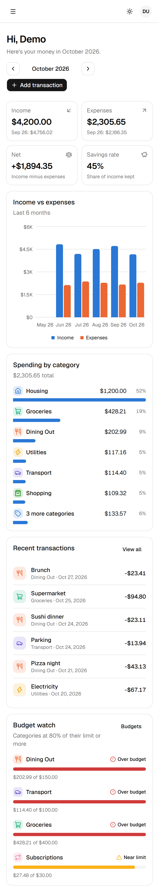

# Finance Tracker

A full-stack personal finance app: log income and expenses, organize them into categories, set monthly budgets, and see where your money goes on a dashboard.

**Live demo:** _add your Vercel URL here_ · Click **Try the demo** to explore a pre-filled account without signing up.



## Features

- **Accounts:** sign up, log in, log out, change password, forgot password (email reset link), delete account
- **Transactions:** add, edit, delete; filter by month, type and category; search notes; pagination
- **Categories:** custom name, color and icon; default set created for every new account
- **Budgets:** monthly limit per category, warnings at 80% and 100%, copy last month's budgets
- **Dashboard:** monthly totals, savings rate, spending by category, 6-month income vs expenses chart
- **CSV export** of one month or your whole history
- **English and Khmer (ខ្មែរ)**: switch with the 🇬🇧 / 🇰🇭 flags; dates, money and starter categories follow the language
- **Dark mode**, responsive down to phone width, keyboard and screen-reader friendly
- **One-click demo** with six months of realistic sample data: every visitor gets a private copy, deleted after 24 hours

| Dark mode                                                       | Budgets                                                | Mobile                                                              |
| --------------------------------------------------------------- | ------------------------------------------------------ | ------------------------------------------------------------------- |
|  |  |  |

## Tech stack

| Area       | Choice                                                       |
| ---------- | ------------------------------------------------------------ |
| Framework  | Next.js 16 (App Router, Server Components, Server Actions)   |
| Language   | TypeScript                                                   |
| Database   | PostgreSQL 16 with Drizzle ORM and SQL migrations            |
| Auth       | Custom: bcrypt password hashing + signed JWT session cookie  |
| UI         | Tailwind CSS v4, shadcn/ui (Base UI), Recharts, lucide icons |
| Validation | Zod, shared by forms and server                              |
| Testing    | Vitest (unit), Playwright (end-to-end)                       |
| CI         | GitHub Actions: format, lint, typecheck, tests, build, e2e   |

## Engineering decisions

Things worth looking at in the code:

- **Money is stored as integer cents.** Amounts are parsed from strings without ever touching floating point, so `0.1 + 0.2` problems can't happen. See [`src/lib/money.ts`](src/lib/money.ts).
- **Two layers of auth.** A [proxy](src/proxy.ts) does a fast cookie check to redirect signed-out visitors, and a [Data Access Layer](src/lib/auth.ts) does the real check. Every Server Action re-verifies the session itself instead of trusting the page.
- **Every query is scoped to the signed-in user**, and ids that come from the browser (like a category id on a new transaction) are checked for ownership before use.
- **The database enforces the rules too:** amounts must be positive (`CHECK`), one budget per category per month (unique index), and a category with transactions can't be deleted (`ON DELETE RESTRICT`). Schema: [`src/db/schema.ts`](src/db/schema.ts).
- **Filters live in the URL**, so a filtered view can be bookmarked or shared and survives a refresh.
- **Security details:** passwords hashed with bcrypt, httpOnly session cookie, login errors don't reveal which emails exist, the post-login `?next=` redirect only allows same-site paths, and CSV export neutralizes spreadsheet formulas (CSV injection).
- **Password reset done carefully.** Reset links work once and expire after an hour, and only a SHA-256 hash of the token is stored. The form gives the same answer (and sends the email after responding, so timing matches) whether or not an account exists. Requests are limited to 3 per hour. Email links use the configured `APP_URL`, never the request's Host header (host header poisoning). Resetting or changing a password logs out every other device: sessions issued before the change are rejected by the Data Access Layer.
- **Streaming with Cache Components.** Static parts of each page (navigation, headers) prerender instantly, and the parts that read your data stream in behind `<Suspense>` with skeletons.
- **Accessible charts.** Colors come from a colorblind-safe palette with separate dark-mode values, spending is shown as ranked bars instead of a pie, budget status always has an icon and a label (never color alone), and the chart has a screen-reader table of its data.
- **Internationalization without a library.** Every page lives under `/en` or `/km` and is prerendered in both. The proxy picks the language (saved choice, then browser language), typed dictionaries make a missing Khmer string a compile error, and a unit test checks nothing was left untranslated. Browsers ship without Khmer `Intl` data (they silently fall back to English), so Khmer dates and money are formatted from built-in tables to keep server and browser output identical. See [`src/i18n/`](src/i18n/).
- **No flash of the wrong theme.** A small inline script applies the saved theme before the first paint, without a theme library.

## Project structure

```
src/
├── app/
│   ├── (auth)/          login and register pages
│   ├── (app)/           signed-in pages: dashboard, transactions, categories, budgets, settings
│   ├── api/export/      CSV download route
│   └── page.tsx         landing page
├── components/          UI, grouped by feature (ui/ holds shadcn primitives)
├── db/schema.ts         tables, constraints and relations
├── lib/                 pure logic: money, dates, validation, sessions (unit tested)
├── server/
│   ├── actions/         Server Actions (all writes)
│   └── queries/         read queries
└── proxy.ts             redirects signed-out visitors
drizzle/                 SQL migrations
tests/e2e/               Playwright tests
```

## Running locally

**Requirements:** Node.js 20.19+ (22 or 24 recommended), Docker Desktop.

```bash
git clone <your-repo-url> finance-tracker
cd finance-tracker
npm install

cp .env.example .env          # then set SESSION_SECRET to a random string
npm run db:up                 # start Postgres in Docker (port 5436)
npm run db:migrate            # create the tables

npm run dev                   # http://localhost:3000
```

### Scripts

| Command                 | What it does                                   |
| ----------------------- | ---------------------------------------------- |
| `npm run dev`           | Start the dev server                           |
| `npm run build`         | Production build                               |
| `npm test`              | Unit tests (Vitest)                            |
| `npm run test:e2e`      | End-to-end tests (needs `npm run build` first) |
| `npm run lint`          | ESLint                                         |
| `npm run typecheck`     | TypeScript                                     |
| `npm run format`        | Prettier                                       |
| `npm run db:generate`   | Create a migration after editing the schema    |
| `npm run db:migrate`    | Apply migrations                               |
| `npm run db:studio`     | Browse the database in your browser            |
| `npm run db:clean-demo` | Delete all demo accounts                       |

## Testing

- **Unit tests** cover the pure logic: money parsing, date math, URL filters, validation rules, budget status, CSV escaping and the demo data generator (`src/lib/*.test.ts`).
- **End-to-end tests** drive a real browser against a production build and a real database: registration and login, redirects, transactions CRUD and filtering, categories, budgets, dashboard totals, settings, CSV export, theme persistence and the demo account (`tests/e2e/`).

```bash
npm test
npm run build && npm run test:e2e
```

## Deploying (Vercel + Neon, both free)

1. **Database:** create a project at [neon.tech](https://neon.tech) and copy its **pooled** connection string.
2. **Create the tables** from your machine, pointing at Neon:
   ```bash
   DATABASE_URL="<neon connection string>" npm run db:migrate
   ```
3. **App:** push this repo to GitHub, then import it at [vercel.com/new](https://vercel.com/new).
4. In the Vercel project's **Environment Variables**, add:
   - `DATABASE_URL`: the Neon connection string
   - `SESSION_SECRET`: a new random string (`node -e "console.log(require('crypto').randomBytes(32).toString('base64url'))"`)
   - `APP_URL`: your site's address, e.g. `https://finance-tracker.vercel.app` (used in reset emails; on Vercel the production URL is picked up automatically if you leave it out)
   - `RESEND_API_KEY` and `EMAIL_FROM`: from [resend.com](https://resend.com) (free), so password reset emails are actually sent. Without them, emails are only printed in the server logs.
5. Deploy. Each click on **Try the demo** creates a private demo copy; copies older than a day are removed automatically.

For later schema changes, run `npm run db:migrate` against Neon again before deploying.

## Ideas for next steps

- Recurring transactions (rent, subscriptions)
- Import transactions from a bank CSV
- Multiple accounts or wallets, and transfers between them
- Rate limiting on login
